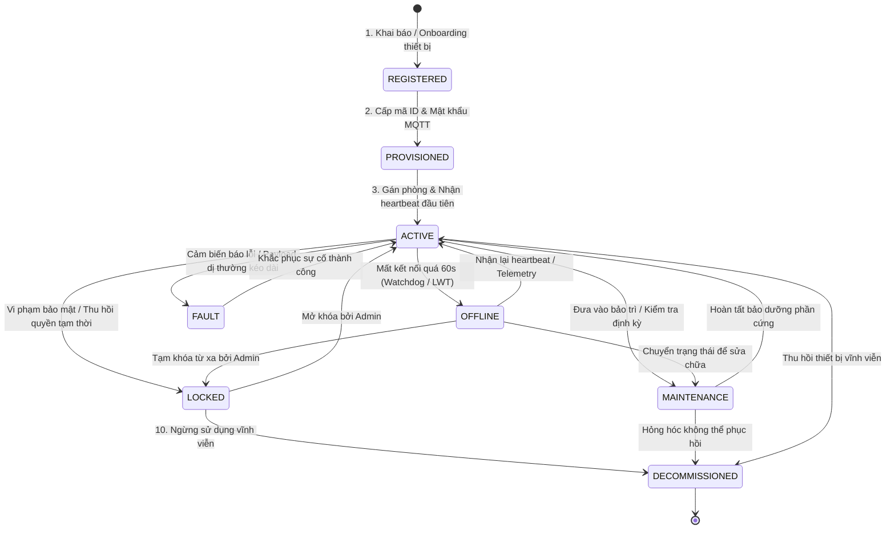

# Quản Lý Vòng Đời Thiết Bị IoT (D12 - Device Lifecycle)

Tài liệu này đặc tả mô hình máy trạng thái (State Machine) và 10 chức năng quản lý vòng đời thiết bị theo đúng yêu cầu tại **Mục 4.4.b của Đề bài Đồ án Học phần IoT và Ứng dụng**.

---

## 1. Sơ Đồ Máy Trạng Thái Vòng Đời Thiết Bị (State Machine Diagram)

---

## 2. Đáp Ứng Đầy Đủ 10 Chức Năng Vòng Đời Thiết Bị (Mục 4.4.b)

| STT | Yêu cầu nghiệp vụ trong Đề bài | Cơ chế triển khai cụ thể tại Backend & CSDL | API / Endpoint tương ứng |
| :---: | :--- | :--- | :--- |
| **1** | **Đăng ký hoặc onboarding thiết bị** | Lưu thông tin phần cứng, gán trạng thái ban đầu là `REGISTERED`. | `POST /api/v1/devices` |
| **2** | **Cấp mã định danh và thông tin xác thực** | Cấp `device_id` duy nhất (vd: `esp32-a-01`), `mqtt_client_id` và sinh băm `credential_hash`. | `POST /api/v1/devices` |
| **3** | **Gán thiết bị cho người dùng/vị trí** | Gán thiết bị vào `room_id` và phân quyền cho người dùng qua bảng `device_assignments`. | `POST /api/v1/devices/{id}/assignments` |
| **4** | **Kích hoạt thiết bị (Activation)** | Chuyển trạng thái sang `ACTIVE` khi thiết bị bắt đầu gửi bản tin telemetry hợp lệ đầu tiên. | `PATCH /api/v1/devices/{id}/lifecycle` |
| **5** | **Cấu hình tham số từ xa** | Gửi lệnh cấu hình chu kỳ lấy mẫu hoặc ngưỡng cục bộ qua topic `/command` hoặc `/config`. | `POST /api/v1/devices/{id}/commands` |
| **6** | **Theo dõi trạng thái online/offline** | Worker nhận bản tin LWT từ Mosquitto và watchdog thread tự động chuyển `OFFLINE` nếu `last_seen_at > 60s`. | Background Supervisor Watchdog |
| **7** | **Theo dõi phiên bản firmware** | Cột `firmware_version` trong bảng `devices` lưu vết phiên bản hiện hành của node. | `GET /api/v1/devices/{id}` |
| **8** | **Ghi nhận lỗi hoặc trạng thái bảo trì** | Chuyển đổi trạng thái sang `FAULT` hoặc `MAINTENANCE` để cách ly thiết bị khỏi luồng điều khiển. | `PATCH /api/v1/devices/{id}/lifecycle` |
| **9** | **Tạm khóa / thu hồi quyền kết nối** | Trạng thái `LOCKED`: Backend từ chối phát lệnh, worker từ chối nhận telemetry, thu hồi Mosquitto ACL. | `PATCH /api/v1/devices/{id}/lifecycle` |
| **10**| **Ngừng sử dụng (Decommission)** | Trạng thái `DECOMMISSIONED`: Đóng vĩnh viễn thiết bị, giữ lại dữ liệu lịch sử phục vụ thống kê (không xóa vật lý). | `PATCH /api/v1/devices/{id}/lifecycle` |

---

## 3. Quy Trình Bảo Mật Khi Thiết Bị Bị Khóa (`LOCKED`)

* **Tại CSDL & API**: Cột `lifecycle = 'LOCKED'`. Khi Operator hoặc Viewer cố tình gọi API gửi lệnh tới node bị khóa, backend lập tức từ chối với mã lỗi `400 Bad Request` ("Cannot dispatch command: Device is currently LOCKED").
* **Tại MQTT Worker**: Worker đối soát trạng thái thiết bị trong bảng `devices`. Mọi gói tin telemetry gửi từ node `LOCKED` đều bị bỏ qua, không được nạp vào bảng `telemetry`.
* **Tại Mosquitto Broker**: Thu hồi quyền trong tệp `deployment/mosquitto/acl` và reload cấu hình broker bằng tín hiệu `SIGHUP` (ca kiểm thử T12).

