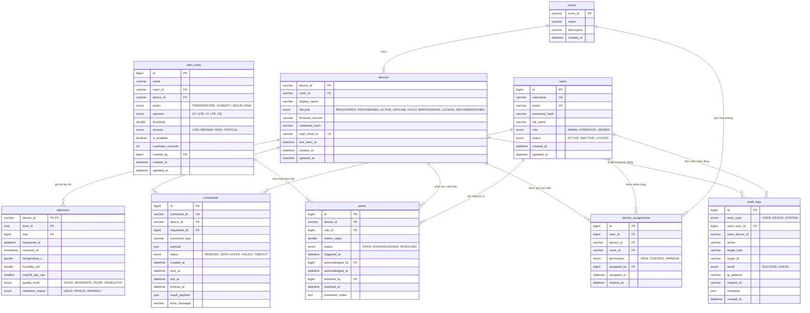

# Thiết kế Cơ sở Dữ liệu & Sơ đồ ERD (D07)

Hệ thống cơ sở dữ liệu được xây dựng trên hệ quản trị **MySQL 8.0 / 8.4 (InnoDB, bảng mã `utf8mb4`)**, đóng vai trò trung tâm lưu trữ dữ liệu chuỗi thời gian (Time-series telemetry), cấu hình vòng đời thiết bị, phân quyền người dùng và nhật ký kiểm toán hệ thống.

---

## 1. Sơ đồ Quan hệ Thực thể (ERD Diagram)

---

## 2. Từ điển Dữ liệu Chi tiết (Data Dictionary)

### 2.1. Bảng `rooms` (Khu vực / Phòng học)
| Tên cột | Kiểu dữ liệu | Ràng buộc | Ý nghĩa nghiệp vụ |
| :--- | :--- | :--- | :--- |
| `room_id` | `VARCHAR(64)` | **PK** | Mã định danh phòng (vd: `room-a`, `room-b`). |
| `name` | `VARCHAR(100)` | NOT NULL | Tên hiển thị của phòng. |
| `description` | `VARCHAR(255)` | NULL | Mô tả diện tích hoặc vị trí cụ thể. |
| `created_at` | `DATETIME(6)` | NOT NULL | Thời điểm tạo phòng (UTC). |

### 2.2. Bảng `users` (Người dùng & Phân quyền)
| Tên cột | Kiểu dữ liệu | Ràng buộc | Ý nghĩa nghiệp vụ |
| :--- | :--- | :--- | :--- |
| `id` | `BIGINT UNSIGNED`| **PK**, AUTO_INCREMENT | Mã người dùng nội bộ. |
| `username` | `VARCHAR(50)` | NOT NULL, **UNIQUE** | Tên đăng nhập. |
| `email` | `VARCHAR(100)` | NOT NULL, **UNIQUE** | Địa chỉ email liên hệ. |
| `password_hash` | `VARCHAR(255)` | NOT NULL | Mật khẩu đã băm an toàn bằng `bcrypt`. |
| `full_name` | `VARCHAR(100)` | NOT NULL | Họ và tên đầy đủ. |
| `role` | `ENUM` | NOT NULL | Vai trò: `ADMIN`, `OPERATOR`, `VIEWER`. |
| `status` | `ENUM` | NOT NULL | Trạng thái: `ACTIVE`, `INACTIVE`, `LOCKED`. |
| `created_at` / `updated_at` | `DATETIME(6)` | NOT NULL | Thời điểm tạo và cập nhật cuối. |

### 2.3. Bảng `devices` (Thiết bị IoT)
| Tên cột | Kiểu dữ liệu | Ràng buộc | Ý nghĩa nghiệp vụ |
| :--- | :--- | :--- | :--- |
| `device_id` | `VARCHAR(64)` | **PK** | Mã định danh thiết bị phần cứng (vd: `esp32-a-01`). |
| `room_id` | `VARCHAR(64)` | **FK** → `rooms` | Phòng chứa thiết bị. |
| `display_name` | `VARCHAR(100)` | NOT NULL | Tên gọi thiết bị trên dashboard. |
| `lifecycle` | `ENUM` | NOT NULL | 8 trạng thái: `REGISTERED`, `PROVISIONED`, `ACTIVE`, `OFFLINE`, `FAULT`, `MAINTENANCE`, `LOCKED`, `DECOMMISSIONED`. |
| `firmware_version`| `VARCHAR(32)` | NOT NULL | Phiên bản firmware (`1.0.0`). |
| `credential_hash` | `VARCHAR(255)` | NULL | Hash mật khẩu MQTT client. |
| `mqtt_client_id` | `VARCHAR(64)` | **UNIQUE** | Client ID kết nối tới Mosquitto. |
| `last_seen_at` | `DATETIME(6)` | NULL | Thời điểm gần nhất nhận được telemetry/heartbeat. |

### 2.4. Bảng `device_assignments` (Phân quyền theo phạm vi - Device Scope)
| Tên cột | Kiểu dữ liệu | Ràng buộc | Ý nghĩa nghiệp vụ |
| :--- | :--- | :--- | :--- |
| `id` | `BIGINT UNSIGNED`| **PK**, AUTO_INCREMENT | Khóa phân quyền. |
| `user_id` | `BIGINT UNSIGNED`| **FK** → `users` | Người dùng được cấp quyền. |
| `device_id` | `VARCHAR(64)` | **FK** → `devices` (NULL) | Gán trực tiếp theo thiết bị. |
| `room_id` | `VARCHAR(64)` | **FK** → `rooms` (NULL) | Gán theo toàn bộ thiết bị trong phòng. |
| `permission` | `ENUM` | NOT NULL | Mức quyền: `VIEW`, `CONTROL`, `MANAGE`. |
| `assigned_by` | `BIGINT UNSIGNED`| **FK** → `users` | Quản trị viên phân công. |
| `expires_at` | `DATETIME(6)` | NULL | Thời hạn ủy quyền. |

### 2.5. Bảng `telemetry` (Dữ liệu chuỗi thời gian)
| Tên cột | Kiểu dữ liệu | Ràng buộc | Ý nghĩa nghiệp vụ |
| :--- | :--- | :--- | :--- |
| `device_id` | `VARCHAR(64)` | **PK**, **FK** → `devices` | Mã thiết bị phát tin. |
| `boot_id` | `CHAR(32)` | **PK** | UUID phiên khởi động của ESP32. |
| `seq` | `BIGINT UNSIGNED`| **PK** | Số thứ tự gói tin trong phiên. |
| `measured_at` | `DATETIME(6)` | NOT NULL | Thời điểm đo tại node cảm biến (UTC). |
| `received_at` | `TIMESTAMP(6)` | NOT NULL | Thời điểm backend nhận và lưu (UTC). |
| `temperature_c` | `DOUBLE` | NOT NULL | Nhiệt độ môi trường (°C). |
| `humidity_pct` | `DOUBLE` | NOT NULL | Độ ẩm không khí (%). |
| `mq135_adc_raw` | `SMALLINT UNSIGNED`| NOT NULL | Số đo ADC 12-bit thô từ MQ-135 (0–4095). |
| `quality_level` | `ENUM` | NOT NULL | Đánh giá mức chất lượng: `GOOD`, `MODERATE`, `POOR`, `UNHEALTHY`. |
| `validation_status`| `ENUM` | NOT NULL | Trạng thái xác thực dữ liệu: `VALID`, `INVALID`, `ANOMALY`. |

### 2.6. Bảng `alert_rules` (Quy tắc ngưỡng cảnh báo)
| Tên cột | Kiểu dữ liệu | Ràng buộc | Ý nghĩa nghiệp vụ |
| :--- | :--- | :--- | :--- |
| `id` | `BIGINT UNSIGNED`| **PK**, AUTO_INCREMENT | Khóa chính quy tắc. |
| `name` | `VARCHAR(100)` | NOT NULL | Tên gợi nhớ quy tắc. |
| `metric` | `ENUM` | NOT NULL | Đại lượng: `TEMPERATURE`, `HUMIDITY`, `MQ135_RAW`. |
| `operator` | `ENUM` | NOT NULL | Phép toán: `GT` (>), `GTE` (>=), `LT` (<), `LTE` (<=), `EQ` (=). |
| `threshold` | `DOUBLE` | NOT NULL | Ngưỡng kích hoạt cảnh báo. |
| `severity` | `ENUM` | NOT NULL | Mức nghiêm trọng: `LOW`, `MEDIUM`, `HIGH`, `CRITICAL`. |
| `cooldown_seconds`| `INT UNSIGNED` | NOT NULL (300) | Thời gian giãn cách giữa các lần kích hoạt liên tiếp (chống spam). |

### 2.7. Bảng `alerts` (Sự kiện cảnh báo)
| Tên cột | Kiểu dữ liệu | Ràng buộc | Ý nghĩa nghiệp vụ |
| :--- | :--- | :--- | :--- |
| `id` | `BIGINT UNSIGNED`| **PK**, AUTO_INCREMENT | Khóa chính sự kiện. |
| `device_id` | `VARCHAR(64)` | **FK** → `devices` | Thiết bị kích hoạt cảnh báo. |
| `rule_id` | `BIGINT UNSIGNED`| **FK** → `alert_rules` | Luật ngưỡng bị vi phạm. |
| `metric_value` | `DOUBLE` | NOT NULL | Giá trị thực tế tại thời điểm kích hoạt. |
| `status` | `ENUM` | NOT NULL | Vòng đời cảnh báo: `OPEN`, `ACKNOWLEDGED`, `RESOLVED`. |
| `triggered_at` | `DATETIME(6)` | NOT NULL | Thời điểm phát sinh cảnh báo (UTC). |
| `acknowledged_by`| `BIGINT UNSIGNED`| NULL, **FK** → `users` | Người vận hành tiếp nhận sự cố. |
| `resolved_by` | `BIGINT UNSIGNED`| NULL, **FK** → `users` | Người xác nhận khắc phục xong. |
| `resolution_notes`| `TEXT` | NULL | Ghi chú giải pháp xử lý. |

### 2.8. Bảng `commands` (Lệnh điều khiển cơ cấu chấp hành)
| Tên cột | Kiểu dữ liệu | Ràng buộc | Ý nghĩa nghiệp vụ |
| :--- | :--- | :--- | :--- |
| `id` | `BIGINT UNSIGNED`| **PK**, AUTO_INCREMENT | Khóa kỹ thuật. |
| `command_id` | `VARCHAR(64)` | NOT NULL, **UNIQUE** | UUID lệnh duy nhất (khóa idempotency). |
| `device_id` | `VARCHAR(64)` | **FK** → `devices` | Thiết bị nhận lệnh. |
| `requested_by` | `BIGINT UNSIGNED`| **FK** → `users` | Người dùng phát lệnh (Operator/Admin). |
| `command_type` | `VARCHAR(50)` | NOT NULL | Loại lệnh (`FAN_SET`, `LED_SET`). |
| `payload` | `JSON` | NOT NULL | Tham số lệnh (`{"action":"FAN_SET","value":"ON"}`). |
| `status` | `ENUM` | NOT NULL | Trạng thái: `PENDING`, `SENT`, `ACKED`, `FAILED`, `TIMEOUT`. |
| `timeout_at` | `DATETIME(6)` | NOT NULL | Thời điểm hết hạn nếu không có phản hồi ACK. |
| `result_payload`| `JSON` | NULL | Dữ liệu phản hồi ACK từ firmware ESP32. |

### 2.9. Bảng `audit_logs` (Nhật ký kiểm toán an toàn thông tin)
| Tên cột | Kiểu dữ liệu | Ràng buộc | Ý nghĩa nghiệp vụ |
| :--- | :--- | :--- | :--- |
| `id` | `BIGINT UNSIGNED`| **PK**, AUTO_INCREMENT | Mã bản ghi log bất biến (`append-only`). |
| `actor_type` | `ENUM` | NOT NULL | Chủ thể thực hiện: `USER`, `DEVICE`, `SYSTEM`. |
| `actor_user_id`| `BIGINT UNSIGNED`| NULL, **FK** → `users` | Tài khoản người dùng thực hiện. |
| `action` | `VARCHAR(64)` | NOT NULL | Hành động: `LOGIN_SUCCESS`, `SEND_COMMAND`, `DEVICE_LIFECYCLE_CHANGE`,... |
| `target_type` | `VARCHAR(64)` | NOT NULL | Đối tượng bị tác động (`USER`, `DEVICE`, `COMMAND`, `ALERT`). |
| `target_id` | `VARCHAR(64)` | NOT NULL | Mã đối tượng bị tác động. |
| `result` | `ENUM` | NOT NULL | Kết quả: `SUCCESS`, `FAILED`. |
| `ip_address` | `VARCHAR(45)` | NULL | Địa chỉ IP của máy khách. |
| `metadata` | `JSON` | NULL | Ngữ cảnh hành động (đã bóc tách mật khẩu/token). |
| `created_at` | `DATETIME(6)` | NOT NULL | Thời điểm phát sinh sự kiện (UTC). |

---

## 3. Chiến lược Chỉ mục (Indexing Strategy)

* `ix_telemetry_device_measured (device_id, measured_at DESC)`: Tối ưu hóa truy vấn chuỗi thời gian phân trang và vẽ biểu đồ lịch sử (SC-02, T06).
* `ix_alerts_device_status (device_id, status)`: Tối ưu hóa truy vấn các cảnh báo chưa xử lý (`OPEN`) trên màn hình Dashboard.
* `ix_commands_status_timeout (status, timeout_at)`: Tối ưu hóa worker watchdog quét các lệnh quá hạn để đánh dấu `TIMEOUT` (T13).
* `ix_audit_actor (actor_type, actor_user_id, created_at DESC)`: Tối ưu hóa tra cứu nhật ký kiểm toán theo người dùng (T15).

