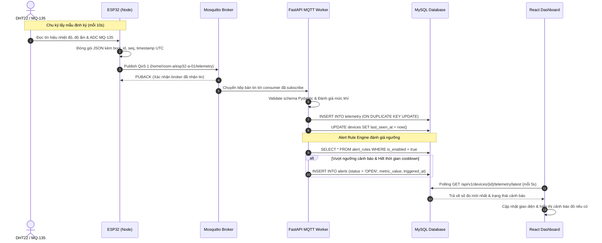
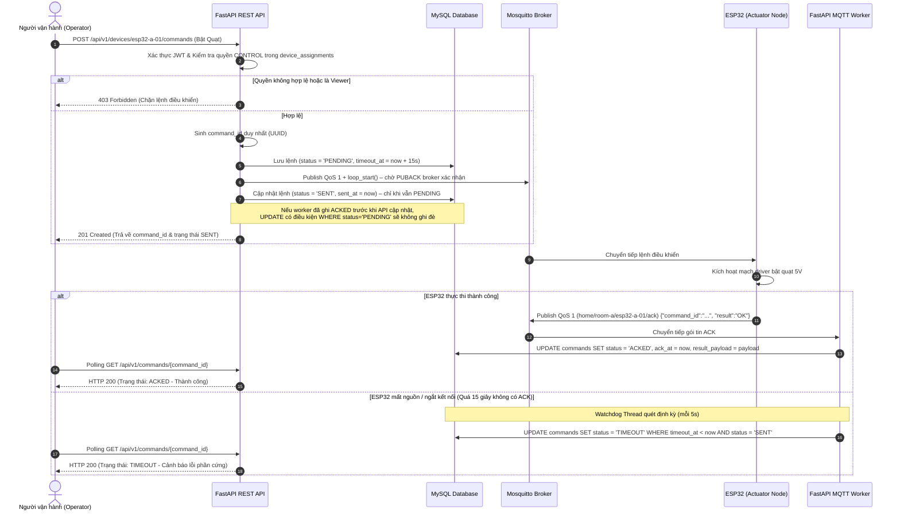

# Sơ Đồ Tuần Tự Hệ Thống (D10, D11 - Sequence Diagrams)

Tài liệu này đặc tả sơ đồ tuần tự cho 2 quy trình vận hành cốt lõi nhất của hệ thống theo yêu cầu tại **Mục 6 của Đề bài Đồ án**:
1. **Quy trình 1 (D10)**: Thu thập dữ liệu cảm biến, lưu trữ chuỗi thời gian và kích hoạt cảnh báo ngưỡng (Telemetry & Alerting Flow).
2. **Quy trình 2 (D11)**: Gửi lệnh điều khiển hai chiều, nhận phản hồi ACK và giám sát Timeout (Command & ACK Flow).

---

## 1. Quy Trình 1: Thu Thập Telemetry & Kích Hoạt Cảnh Báo (D10)

---

## 2. Quy Trình 2: Điều Khiển Hai Chiều & Theo Dõi ACK / Timeout (D11)

